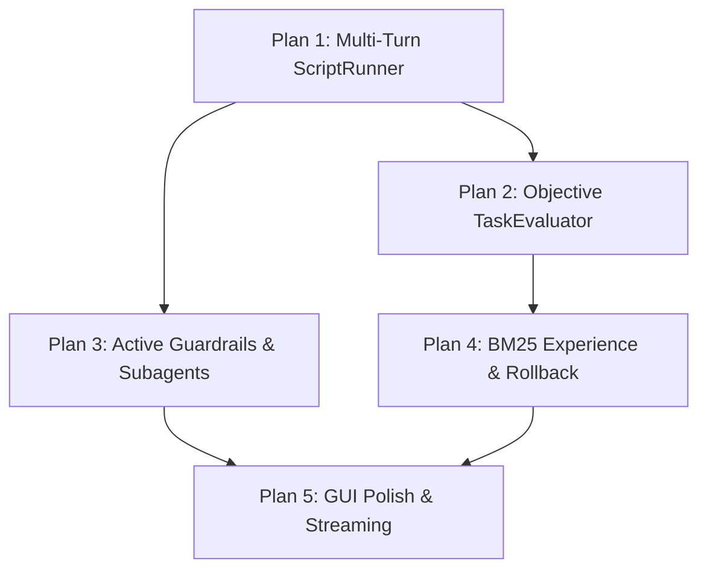

# System Architecture Plans — Phase 4 Roadmap

This document outlines the detailed implementation plans for transitioning the **Harness²** system from the current Phase 1–3 foundation to a production-grade recursive self-improving agent platform.

---

## Executive Gap Summary

| Subsystem | Completed Foundation (Phases 1–3) | Phase 4 Implementation Plan |
| :--- | :--- | :--- |
| **Tool Execution** | Single-turn simulated JSON responses | Multi-turn ReAct loop with real `ScriptRunner` (`tokio::process::Command`) |
| **Scoring & Verification** | Self-reported LLM `score` and `succeeded` | Deterministic `TaskEvaluator` (JSON schema, exit codes, verifier scripts) |
| **Harness Components** | Passive prompt text injection + basic JSON parse | Active runtime hooks for `Guardrails`, `Subagents`, and `Plugins` |
| **Experience Memory** | Full-file read & append in `EXPERIENCE.md` | Top-$K$ BM25 relevance retrieval + versioned harness rollback history |
| **Desktop Studio** | Single-line inspector input, monolithic task | Multi-line `text_editor`, live stage streaming, on-disk session persistence |

---

## Plan 1: Real Multi-Turn Tool & Script Execution (`ScriptRunner`)

### 1.1 Objective
Transition from single-turn simulated tool outputs to a robust, sandboxed multi-turn ReAct loop that executes real shell commands, scripts, and registered native Rust handlers.

### 1.2 Target Components (`crates/ecoharness`)
* **`ToolRegistry`**:
  * Scans and parses tool definitions declared in `scripts/manifest.md` or a structured `scripts/tools.json`.
  * Maintains a mapping of tool names to executable scripts, shell commands, or native Rust closures.
* **`ScriptRunner`**:
  * Spawns sandboxed child processes using `tokio::process::Command`.
  * Enforces strict working directory confinement within the active probe/base workspace.
  * Captures real `stdout`, `stderr`, and exit codes with execution timeouts (e.g., 30s cap).
* **Multi-Turn ReAct Loop (`HarnessEngine::execute_task_multiturn`)**:
  * Configurable turn limit: `max_turns: usize` (default: 8 turns) to prevent small models from entering repetitive loops.
  * When the model emits `tool_name` and `tool_input`:
    1. Intercepts the call and invokes `ScriptRunner`.
    2. Constructs a new `TrajectoryStep` populated with actual `tool_output` or execution errors.
    3. Appends the step to the conversation trace and queries the model for the next turn.
    4. Terminates when the model emits `final_output` or reaches `max_turns`.

---

## Plan 2: Objective External Scoring (`TaskEvaluator` Trait)

### 2.1 Objective
Eliminate reliance on self-graded LLM scores (`score: f32` emitted by the model) by introducing deterministic, external verification gates for Reference and Probe runs.

### 2.2 Target Components (`crates/ecoharness`)
* **`TaskEvaluator` Trait**:
  ```rust
  #[async_trait]
  pub trait TaskEvaluator: Send + Sync {
      async fn evaluate(
          &self,
          workspace: &HarnessWorkspace,
          trajectory: &Trajectory,
      ) -> Result<EvaluationVerdict, HarnessError>;
  }

  pub struct EvaluationVerdict {
      pub score: f32,
      pub succeeded: bool,
      pub diagnostic_error: Option<String>,
  }
  ```
* **`JsonSchemaEvaluator`**:
  * Validates `trajectory.final_output` against a target JSON schema.
  * Assigns `1.0` if output matches all required types and fields.
  * Assigns `0.0`–`0.5` on validation failure and injects specific schema errors into the final step trace, giving the Proposer actionable critique.
* **`ScriptVerifierEvaluator`**:
  * Runs a verification script or test command (e.g. `cargo check`, unit tests, regex matchers).
  * Computes `score` based on process exit codes and test pass ratios.
* **Engine Integration**:
  * `HarnessEngine` invokes the configured `TaskEvaluator` after reference and probe runs, overriding model-reported scores before the regression gate and compose steps.

---

## Plan 3: Active Runtime Enforcement for Guardrails, Subagents, and Plugins

### 3.1 Objective
Upgrade the passive markdown components into active, executable runtime middleware interceptors that protect the host system and expand multi-agent capabilities.

### 3.2 Target Components (`crates/ecoharness`)
* **`GuardrailEnforcer` (`guardrails.md`)**:
  * Pre-execution inspection hook evaluated *before* `ScriptRunner` executes any command.
  * Blocks dangerous system commands (e.g. `rm -rf`, format drives, unauthorized network access).
  * Prevents path traversal outside designated workspace and sandbox boundaries.
* **`SubagentDispatcher` (`subagents.json`)**:
  * Deserializes `subagents.json` into typed agent configurations:
    ```rust
    pub struct SubagentConfig {
        pub name: String,
        pub model: String,
        pub system_prompt: String,
        pub allowed_tools: Vec<String>,
    }
    ```
  * Registers a built-in tool `call_subagent(name: String, task: String)` allowing the primary Executor to delegate specialized subtasks to independent Ollama instances.
* **`PluginMiddleware` (`plugins/manifest.md`)**:
  * Pipeline hooks:
    * `pre_prompt`: Sanitizes user inputs, injects context, formats tokens.
    * `post_response`: Automatically detects and repairs malformed JSON before deserialization, records turn latency, and monitors token budgets.

---

## Plan 4: Scalable `EXPERIENCE.md` Retrieval & Harness Version Rollback

### 4.1 Objective
Prevent prompt token saturation as the experience log accumulates, while enabling historical auditability and instant rollback to prior harness versions.

### 4.2 Target Components (`crates/ecoharness`)
* **Top-$K$ Experience Retrieval**:
  * Implements a lightweight in-memory BM25 or keyword frequency relevance scorer.
  * When `EXPERIENCE.md` exceeds budget limits (e.g., > 15 lessons):
    1. Scores all historical lessons against the current `task_prompt` and compressed error trace.
    2. Injects only the top 3 most relevant lessons into the Proposer prompt.
  * Preserves prompt headroom for compact models (`LFM2.5-350M`).
* **Harness Versioning & Rollback (`history/v{N}`)**:
  * Before committing adopted diffs, the engine saves a snapshot checkpoint into `history/v{N}/`.
  * Maintains a `manifest.json` tracking commit timestamps, winning scores, and adopted diff summaries.
  * Enables instant programmatic or GUI-driven rollback to any historical harness checkpoint.

---

## Plan 5: `ecoharness-gui` Production Polish

### 5.1 Objective
Elevate the desktop workbench from an MVP into a production-grade developer tool with multi-line code editing, live stage streaming, and persistent storage.

### 5.2 Target Components (`crates/ecoharness-gui`)
* **True Multi-Line Editor (`iced::widget::text_editor`)**:
  * Replace the single-line `text_input` in the 8-File Harness Inspector with `iced::widget::text_editor::Content`.
  * Support multi-line syntax viewing, line numbers, cursor navigation, and text selection for Markdown and JSON.
* **Live Stage & Token Streaming (`iced::Subscription` / `tokio::sync::mpsc`)**:
  * Replace the monolithic `Task::perform` in Plan Mode with a progress event channel:
    * `PpcStage::ReferenceRunStarted`
    * `PpcStage::ReferenceRunCompleted(score)`
    * `PpcStage::ProposingCandidates`
    * `PpcStage::ProbingCandidatesConcurrent`
    * `PpcStage::CompositionDecision(winner)`
  * Right Pane displays real-time status cards showing probe progress as it happens.
  * Integrates Ollama streaming (`"stream": true`) for real-time turn text generation.
* **On-Disk Session Persistence (`sessions.json`)**:
  * Serialize `Vec<ChatSession>` to `<workspace_root>/sessions.json` on changes.
  * Reload conversation sessions, message histories, and Plan Mode diff chips upon app launch.

---

## Recommended Implementation Order



1. **Step 1 (Core Execution)**: Implement Plan 1 (`ScriptRunner` + ReAct loop) and Plan 2 (`TaskEvaluator`) to establish true autonomous execution and objective validation.
2. **Step 2 (Safety & Scaling)**: Implement Plan 3 (`GuardrailEnforcer`, `SubagentDispatcher`) and Plan 4 (Top-$K$ Experience Retrieval).
3. **Step 3 (GUI Modernization)**: Implement Plan 5 (`text_editor`, live event streaming, and session persistence in `ecoharness-gui`).
